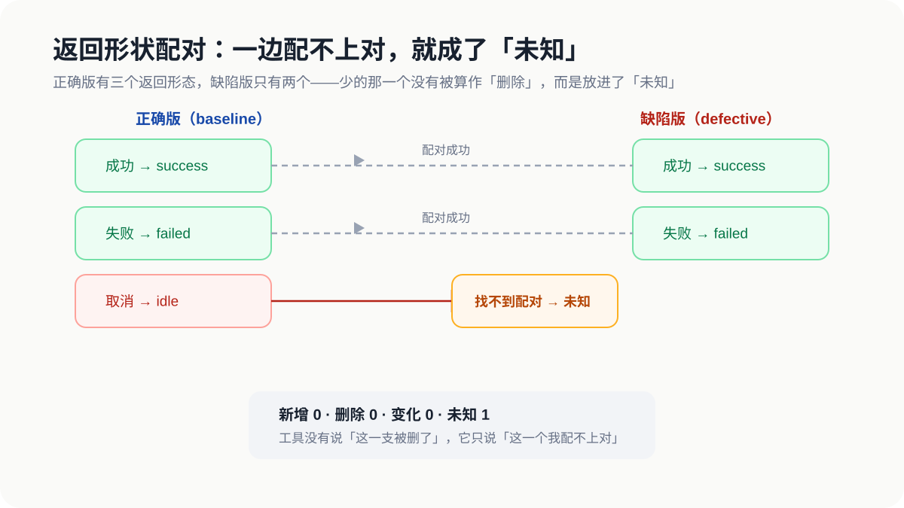
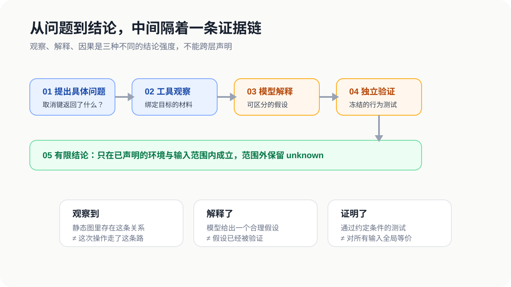
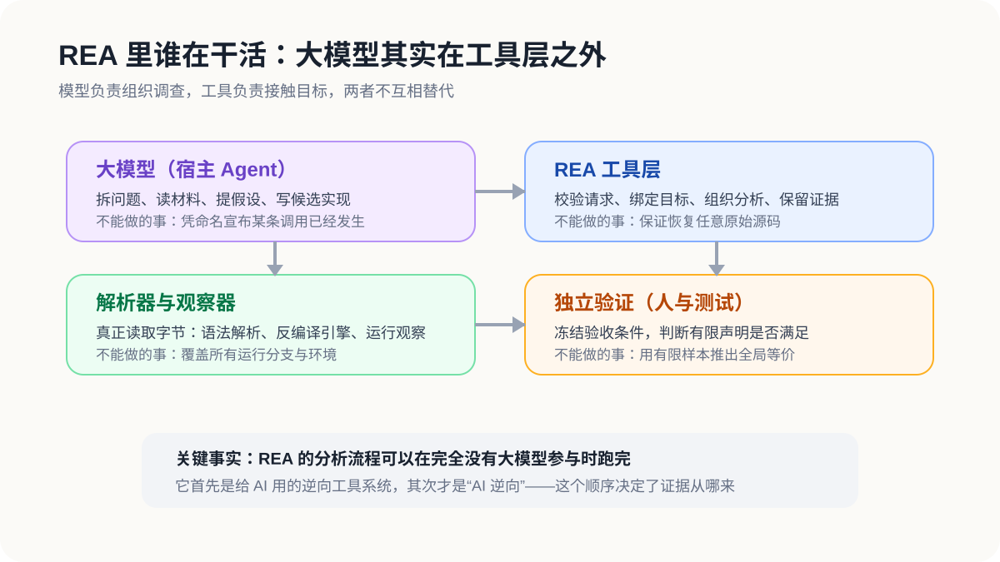
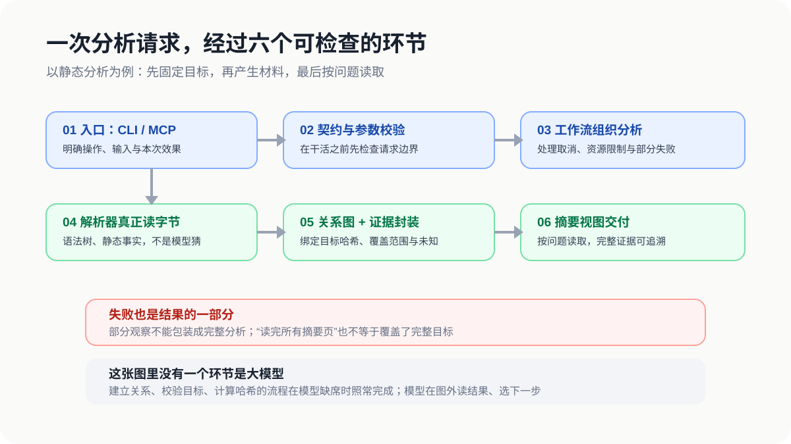
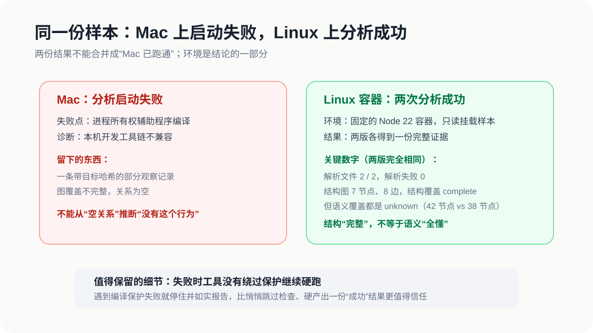
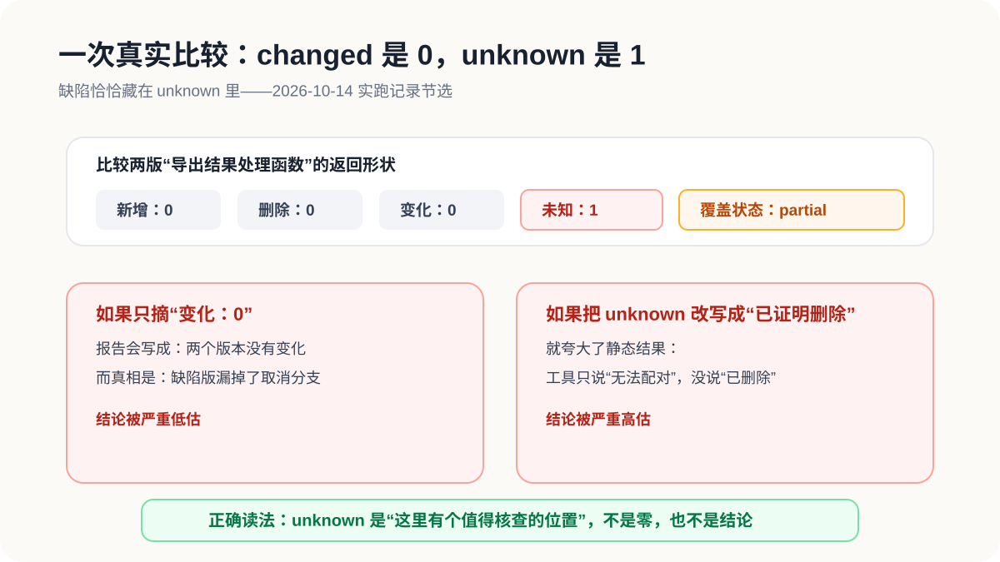
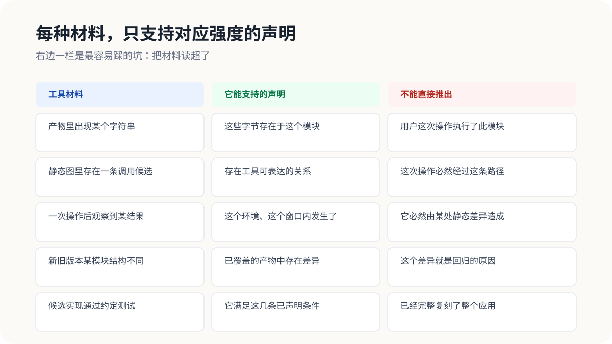
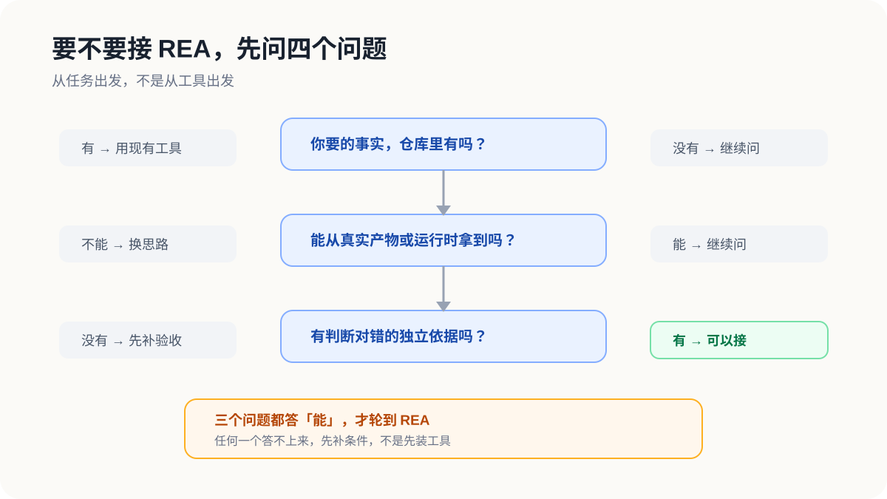
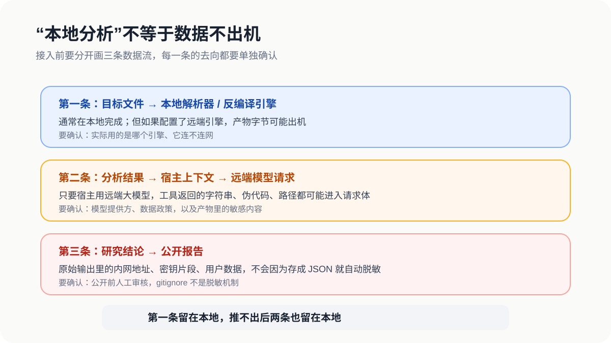

# REA 实跑记：一套给 AI 用的逆向工具，先教会我「老实说不知道」

最近在研究 REA（Reverse Engineer Anything），一套给 AI Agent 用的逆向工程工具系统。这篇文章里的所有结论，都来自对 REA 固定版本源码的阅读，和一次真实实跑——我拿它分析了自己构造的样本。

先说那次实跑里印象最深的一个结果，因为它直接决定了这篇文章要讲什么。

我写了两个版本的程序：一个正确版，一个缺陷版。场景是一个导出按钮——正确版能区分三种结果：成功、失败、用户点了取消；缺陷版漏掉了取消这条分支，会把"用户点了取消"当成"导出成功"返回。两版代码的其他部分完全一样。

然后我用 REA 比较这两个版本里同一个处理函数。比较的逻辑是：把函数可能返回的所有结果形态在两边逐一配对——一边有、另一边也有的，算"无变化"；一边多出来的，算"新增"；一边少了的，算"删除"。

工具返回的摘要是：新增 0、删除 0、变化 0。按字面理解，两版在这个函数上没差别，可以收工。

但摘要里还有一项：未知 1。意思是，正确版里有一个返回形态，工具在缺陷版那边配不上对——找不到能确定的对应关系，就没把它算进"新增、删除、变化"任何一类，单独放进了"未知"。

顺着这个未知查下去，它定位到的位置，正是被删掉的那条取消分支。

最抓眼球的三个零是误导，真正指向缺陷的是那个不起眼的"1"。如果只看前三个数字就下结论"两版无差异"，这份报告就错了。

这篇文章想讲的，就是这次研究让我想清楚的一件事：AI 辅助逆向的门槛不在模型够不够聪明，而在每个环节愿不愿意对自己的结论强度说实话。

---

## 一、为什么"看起来合理"是逆向里最大的坑

先还原一个典型场景：一个没有完整源码的桌面工具，你想知道它怎么处理剪贴板；或者一个本地 SDK 升级后，同样的输入产出了不同结果。你把能拿到的日志、文档、导出的文件交给模型分析。

模型会给出一段读上去很通顺的解释。问题在于，通顺和可靠是两回事。字符串长得像接口名、两个函数名相似、某次运行结果符合预期，这些材料在模型那里都能变成言之凿凿的结论，但它们本身什么都保证不了。

逆向的难点不在解析。解析器、反编译器都是成熟工具，读字节这件事早就解决了。难的是每条材料能支持多强的结论，得有人讲清楚。"静态图里存在这条调用候选"和"用户这次操作走了这条路"，是两种强度完全不同的声明，混在一份报告里就是事故。

REA 引起我兴趣的原因，是它把"区分结论强度"当成核心设计问题，而不是留给模型自觉处理的副作用。

## 二、REA 的真实结构，和名字给人的印象相反

名字叫"Reverse Engineer Anything"，直觉上是一个大模型读二进制的项目。读完源码（固定在指定提交，发布版 6.4.0）后发现顺序是反的：它首先是一套逆向工具系统，只是接口设计成了给 AI 用。

解析、建关系图、算哈希、封装证据，这些事模型完全不参与也能跑完。模型的位置在工具层之外：宿主 Agent 决定调用哪个工具，读返回的观察，决定下一步查什么。

各方分工如下：

| 参与者 | 负责什么 | 管不了什么 |
|---|---|---|
| 大模型 | 拆问题、解释材料、提假设、写候选实现 | 凭名字像就宣布某条调用发生过 |
| REA 工具层 | 校验请求、绑定目标、组织分析、留证据 | 保证还原任意软件的源码 |
| 解析器 / 观察器 | 真正读字节、看运行 | 覆盖所有分支和环境 |
| 独立测试 | 判定写好的声明是否满足 | 用有限样本推出全局等价 |

这个顺序决定了证据的可信度从哪来。哈希是算出来的，不是模型预测的；语法树是解析出来的，不是模型猜的。模型接手的是"这些材料说明了什么"，而不是材料本身。

## 三、和传统逆向工程的分工差异

传统逆向工程的工具链是"人驱动"的：人决定用哪个反编译器、人看伪代码、人记录发现、人判断下一步查什么。工具之间是孤立的，切换成本全在人身上。

REA 跳出来靠的是把这套流程**工具化、契约化、证据化**，让 AI Agent 能接手"组织调查"这个原本只有人能做的环节。具体说，它做了三件事传统工具没做的：

第一，**统一入口**。不管目标是 JS 目录、ASAR 包、二进制、还是浏览器页面，都走同一套 MCP/CLI 契约，Agent 不需要学十几种工具的用法。

第二，**证据绑定**。每个结果都带目标哈希、工具版本、覆盖范围、限制说明，可以回到具体文件和参数复查，不是一段"模型觉得对"的文字。

第三，**未知管理**。配不上对就写"未知"，解析失败就标"不完整"，而不是像传统流程里那样靠人脑记住"这里我还没搞清楚"。

所以 REA 的核心不是"更强的反编译器"，而是**把逆向工程从"人脑驱动"变成"人机协作、证据可追溯"的工程流程**。

## 四、一次请求在系统里走六个环节，模型一个都不在

沿源码走一遍静态分析路径（比如分析一个本地 JS 目录），一次请求大致经过六个环节：

入口收请求，契约层校验边界，工作流组织执行，解析器真正读文件（这条路径用 Babel 出语法树，目标程序本身不会被执行），然后建关系图、封装证据、绑定目标哈希，最后按问题向调用方交付摘要视图。

两个设计细节值得单独说。

一是失败被当成结果的一部分。文件读不了、解析失败、分析被取消时，系统保留已完成的观察，明确标注"不完整"，而不是拼一份看起来成功的空结果。这对 AI 场景尤其关键：下游模型看到一份"成功但为空"的结果，会顺理成章地认为"这个行为不存在"，这比直接报错危害更大。

二是摘要和覆盖是两回事。证据完整保留，模型按模块分页读取。但"读完了所有页"只说明这个查询窗口到了末尾，不证明前面的页真正进了模型上下文，也不证明原始分析覆盖了全部代码。服务存了记录、工具交付了视图、模型真的读到并用对了，是三件事，前者推不出后者。

## 五、实跑记录：Mac 失败、Linux 成功，和那个指向缺陷的「未知」

读源码只能确认设计意图，实际行为要跑了才知道。前面说的"导出按钮"样本，是我为这次研究专门构造的白盒练习。

先在环境上就失败了。Mac 上分析启动不了：工具有一个进程所有权保护，需要现场编译一个 Swift 辅助程序，本机工具链与之不兼容，换 SDK 也无效。值得记录的是，工具没有绕过保护硬跑，而是停下来，返回一条部分观察记录——绑定了样本哈希，但图不完整。这条记录的正确用法是"记住这里失败过"，不能反过来从空关系里推断"程序没有这个行为"。

换到固定 Node 22 的 Linux 容器，只读挂载样本，两份分析都正常完成。

结果里有一个值得注意的现象。结构层两版完全一致：各 2 个文件、0 解析失败、结构图都是 7 节点 8 边、覆盖完整。语义层则不同：正确版 42 个语义节点，缺陷版 38 个，且两边的语义覆盖状态都是"未知"。

也就是说，只看计数无法定位缺陷。结构层的"完整"和语义层的"未知"是两个独立的信号，必须同时读。

接着聚焦到那个处理函数，跑返回形状比较，得到的就是开头那组数字：新增 0、删除 0、变化 0、未知 1。工具没有说"这一支被删了"，也没有说"两边没区别"，它只说"这一个我配不上对"，位置精确到具体文件的第 2 行。

拿着这个位置核对源码，解释才落地：缺陷版确实少了取消分支。最后是行为验证——同一个"已取消"输入，正确版返回空闲，缺陷版返回成功；再写一个修复版，事先冻结的五项测试全部通过。缺陷版挂掉其中一项是实验设计，不是测试出了问题。

整条链走完，分工清晰：哈希、解析、形状比较由工具完成；组织查询、对照位置、写修复由模型（也就是我）完成；结论对错由测试判定。没有一方替另一方签字。

## 六、这套系统的骨架：材料归材料，结论归结论

那个"未知 1"背后是一整套规则，这是 REA 最值得借鉴的部分。核心一句话：每种材料只支持对应强度的声明。

几条具体的边界。

**置信度不是概率。**REA 的证据分三类：实际观察到的、从观察派生的、基于假设推断的。这是证据的来源分类，不是正确率的刻度。同一句"返回已取消"，来自静态候选、来自一次真实运行、来自模型解释，是三种不同强度的东西。读报告时只摘一个字段说"工具确认了"，是最常见的误用。

**哈希只证明一致，不证明正确。**证据标识能保证记录没被篡改，但一份完全自洽的错误分析，哈希照样正确。哈希管的是"数据没动过"，管不了"理解对不对"。

**未知是有生命周期的。**没解决、被反驳、不在范围内，是三种状态。更新一条未知要带准确的修订号，旧结论不能悄悄覆盖新证据；关闭一条未知必须附证据。这比模型口头说一句"搞定了"要可靠得多。

还有一个更隐蔽的坑：模型和测试串通。如果模型先猜规范，再按猜测写实现，最后写只覆盖自身实现的测试，三方一致也说明不了什么。这次练习里我的做法是：测试在分析之前冻结，修复只能写进独立目录，缺陷版原样保留——验收条件不迁就实现。

## 七、要不要接入，看三条

调研最后要落到"用不用"。我的判断框架是三条。

第一，从问题出发，不从工具出发。值得用的场景有个共同点：要的事实不在仓库里，只能去真实产物或运行时拿——安装包跟源码对不上、闭源 SDK 的参数边界、两版命令行的行为差异。反过来，有完整源码的业务缺陷、文档检索、指标计算，用现有工具更直接。

第二，版本号不代表内容。这次审查绑定的源码提交和 npm 上 6.4.0 对应的发布提交是两棵不同的树，版本号相同。有什么能力，以实际安装的包为准。

第三，"本地分析"不等于数据不出机。三条流向要分开确认：

目标文件进本地解析器，这一步在本地；但分析结果会被宿主 Agent 读进上下文，只要宿主用远端模型，这些内容就可能出机；再往后写进公开报告，原始输出里的路径、密钥片段不会因为存成 JSON 就自动脱敏。第一条在本地，推不出后两条也在。另外，逆向产物里的字符串可能含有针对模型的注入指令，宿主必须把目标内容当数据，不能当指令执行。

## 八、结论

这次研究改变了我对"AI 辅助逆向"的判断。

我原来认为关键在于模型够不够好——能不能读懂汇编，能不能推理协议。现在的看法是，关键在于整条链上每个环节愿不愿意对自己的结论强度说实话：观察就写观察，解释就写解释，配不上的就说配不上，测过的才说通过，测到哪说到哪。

模型的价值在于组织调查、连接材料、提出可验证的假设；工具的价值在于让每一步能回到具体文件、哈希、版本去复查；"结论有多硬"由事先冻结的验收决定，不由任何一方的说辞决定。

一个会在结果里写"未知：1"的工具，比一个永远回答得滴水不漏的工具，更适合让 AI 拿着去碰真实的软件。

## 九、这套组合什么时候靠谱

REA 本身不是一个客户端产品，它是一套工具层。最终交付给用户的"客户端"是宿主 Agent（比如 Claude Code、Codex）加上 REA 工具的组合。这个组合靠不靠谱，取决于三层：

| 层 | 靠谱的条件 | 当前状态 |
|---|---|---|
| REA 工具层 | 契约清晰、失败如实报告、证据可复查 | 源码级验证通过，实跑中 Mac 失败如实报告、Linux 成功带完整证据 |
| 宿主 Agent | 能正确调用工具、不篡改证据、不脑补结论 | 取决于具体 Agent 的实现和提示词设计 |
| 使用方式 | 问题具体、验收独立、范围明确 | 需要用户自己设计，REA 不替你做 |

实跑里 Mac 失败那次的处理方式给了我信心：工具没有硬跑，而是停下来报告"这里编译不了，我只拿到部分观察"。这种"失败也留证据"的行为，比"永远成功"的幻觉更值得信赖。

但"靠谱"有个前提：它适合的是"从真实产物中取得缺失事实"的场景，比如安装包行为和源码对不上、闭源 SDK 的参数边界。如果你指望它"自动逆向任意软件"或者"替代人做安全审计"，那不靠谱。
